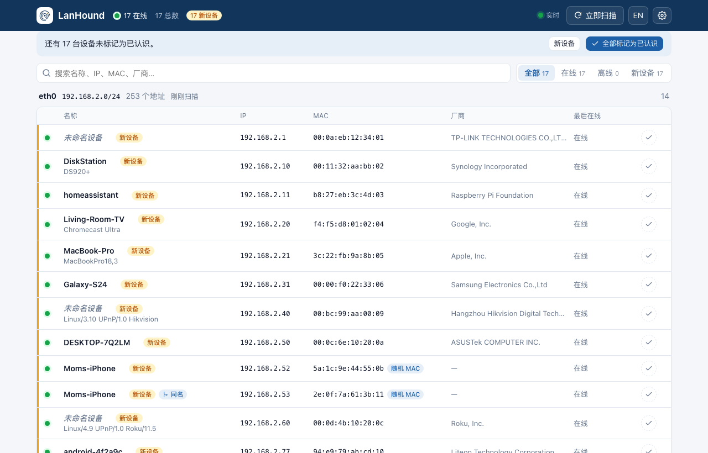

<p align="center">
  
</p>

<h1 align="center">LanHound</h1>

<p align="center">
  零配置的家庭局域网看门狗。<br>
  自动发现家里所有联网设备，记录每台设备的在线历史，
  有陌生设备接入时立刻通过 Telegram 报警。
</p>

<p align="center">
  <a href="README.md">English</a> · <b>简体中文</b>
</p>

<p align="center">
  <a href="https://hub.docker.com/r/passport888/lanhound"></a>
  <a href="https://github.com/playwjj/lanhound/releases"></a>
  <a href="LICENSE"></a>
</p>

<p align="center">
  
</p>

## 快速开始

```sh
docker run -d --name lanhound --restart unless-stopped \
  --network host --cap-add=NET_RAW \
  -v lanhound-data:/data \
  passport888/lanhound
```

同一个多架构镜像（amd64、arm64、armv7）同时发布在 [Docker Hub](https://hub.docker.com/r/passport888/lanhound)（`passport888/lanhound`）和 GitHub（`ghcr.io/playwjj/lanhound`），哪个拉得动用哪个。国内常见的镜像加速一般只缓存 Docker Hub，所以优先用 Docker Hub 的地址。

打开 `http://<主机IP>:8686` 即可。不写配置文件、不用注册账号、没有向导：LanHound 自动识别宿主机所有内网网卡和网段，立即开始看守。

也可以用 Compose，见 [`docker-compose.yml`](docker-compose.yml)：

```sh
docker compose up -d
```

## 功能

- **整个网段一网打尽**：每 5 分钟一次礼貌的 ARP 扫描，同时常驻被动监听 DHCP、mDNS、SSDP、NetBIOS 广播。手机连上 Wi-Fi 通常一两秒内就能被发现，不必等下一轮扫描。IPv6 也支持：每轮向 `ff02::1` 发一个 echo，再加上邻居发现（NDP）监听，记录每台设备的链路本地地址和全局地址。
- **自动给设备起名**：主机名来自 DHCP、mDNS、NetBIOS 和路由器 DNS；厂商来自内置的 IEEE OUI 库（4 万多条）；型号提示（如 *Chromecast Ultra*、*DS920+*）来自 mDNS 和 UPnP。
- **新设备报警**：支持 Telegram 和任意 Webhook。报警内容包含名称、厂商、IP、MAC、首次出现时间，一眼分辨敌友。安装后的首轮扫描是静默基线，不会一上来就刷 30 条消息。
- **应对随机 MAC**：手机会对每个网络换一个 MAC。LanHound 为每台设备做指纹（主机名、mDNS 型号、DHCP 选项 55/60 指纹）。一个“新” MAC 和已知设备吻合时，会提示“很可能是 X 换了随机 MAC”，并提供一键**合并**。"iPhone"这类通用名只算弱证据；同时在线的两个 MAC 永远不会被当成一台设备。高置信度地匹配到你已标记为认识的设备时，不发报警，只在告警记录里记一笔。合并后保留所有 MAC 和完整历史。
- **在线历史**：按设备记录上线/离线时段及 IP 变更、主机名变更等事件，提供最近 7 天在线时间轴、每台设备的"常在线时段"热力图，以及全网每小时在线设备数的活跃度热力图；默认保留 90 天，存在单个 SQLite 文件里。
- **实时、好用的 Web 界面**：状态实时推送，支持搜索筛选、行内改名、标记“已认识”、添加备注，手机上也能看，中英双语。
- **安全告警**（只检测、只报警）：
  - **ARP 欺骗 / IP 冲突**：两个 MAC 同时声称拥有同一个 IP。涉及网关时按严重告警处理。
  - **ARP 泛洪**：某台设备短时间内发出大量未经请求的 ARP。
  - **网关 MAC 变更**：默认网关忽然从另一个 MAC 应答。
  - **野 DHCP 服务器**：网段里出现第二个分配地址的设备，最常见的是没关 DHCP 的旁路由。
  - **关键设备**：把 NAS、摄像头标为关键设备，离线和恢复在线时都会通知你。

  所有告警都会记录在界面的告警记录（🔔）里，没开通知也能看到。
- **有线还是无线**：两者在网线上看起来一模一样，所以 LanHound 如实标注。接了 OpenWrt 路由器数据源后能确切知道，直接读路由器自己的客户端列表，显示"无线 · 5 GHz · −52 dBm"。否则给出带"?"的推测并注明理由（随机 MAC、Wi-Fi 芯片厂商、手机 → 无线；路由器、NAS → 有线），没把握就不标。
- **多网卡**：有线 + Wi-Fi 双栖、双网口小主机，每个广播域各起一个监听，设备按接口分组展示；网卡增减自动跟随。

<p align="center">
  
  &nbsp;
  
</p>

## 报警配置

在 Web 界面点**设置**（⚙），填入 Telegram Bot Token（找 [@BotFather](https://t.me/BotFather) 创建）和你的 Chat ID，点**发送测试**即可。报警语言可选中文。

Webhook 会收到一个 JSON POST，字段说明见[英文 README](README.md#alerts)。其中 `text`/`content` 是渲染好的消息文本，Slack、Discord 类的入站 Webhook 可以直接用。

**国内网络访问不了 `api.telegram.org`？** 在设置里填 Bot API 反代地址，或给容器设置 `HTTPS_PROXY` 环境变量。

<p align="center">
  
</p>

### 安全检测能看到什么、看不到什么

在交换机网络里，一台主机只能收到广播和发给自己的流量。攻击者对整个网段投毒（常见工具的默认模式），或者对 LanHound 所在主机投毒时，LanHound 能发现；只针对另外两台机器的定向欺骗，任何被动监听都看不到。网关 MAC 检测和 DHCP 检测不受这个限制。为了发现 DHCP 服务器，LanHound 每 30 分钟广播一次 DHCPDISCOVER，之后不会再发 REQUEST，不会占用地址；设置 `LANHOUND_DHCP_PROBE=off` 可关闭。第一个见到的 DHCP 服务器默认可信，其他服务器可以在告警里一键信任。

## 读取路由器 / 光猫设备表（可选）

ARP 只能看到 LanHound 所在的广播域。如果想把路由器后面的设备也列进来（其他网段、访客网络、双层 NAT 中光猫那一侧），并直接从租约表拿到 DHCP 主机名，可以在**设置 → 路由器**里添加数据源：

- **OpenWrt**（包括 ImmortalWrt、iStoreOS、Kwrt 等衍生版）：填 LuCI 地址和路由器账号。LanHound 每 2 分钟调用几个只读接口：`luci-rpc getDHCPLeases` / `getHostHints` 获取设备和名称，`iwinfo assoclist` 获取哪些设备连在它的 Wi-Fi 上（频段、信号强度）。
- **网址**：任何能提供 dnsmasq 租约文件、`/proc/net/arp`、`ip neigh` / `arp -a` 输出或 CSV（`mac,ip,名称`）的地址。其他品牌路由器和光猫走这条路，比如用定时任务把光猫的设备列表导出到一个 LanHound 能访问的地方。

本网段设备的在线状态仍以 ARP 为准，只从路由器拿名字，因为路由器表里常有过期条目。只有路由器知道的设备单独分组显示。每个数据源第一次同步不报警，和首轮扫描一样。密码保存在本机数据库里。

## 服务识别（可选，默认关闭）

在**设置 → 发现**里开启后，LanHound 会识别每台设备运行的服务。每台设备每天探测一次（新设备立即探测）：一次只探测一台，对约 20 个常见端口（SSH、网页、SMB、AFP、RTSP、IPP/9100、RDP/VNC、AirPlay、Cast、Plex、Home Assistant 等）发起 TCP 连接，读取网页标题和 SSH 标识，据此推断设备类型（NAS、摄像头、打印机、路由器、电脑、手机、影音设备、服务器、智能家居）。网页管理界面会在设备详情里变成可点击的链接。**开着 Telnet 的设备会标红**，便宜的摄像头和运营商光猫上仍然很常见。

这本质上是（很轻的）端口扫描，所以需要手动开启，请只在你自己的网络上使用。`lanhound probe <IP>` 可以在命令行单独跑一次同样的探测，设备详情里也有"立即探测"按钮。

## 远程探针（VLAN、访客网络）

LanHound 每个网卡只能看到一个广播域。对于它到不了的网段（VLAN、访客 Wi-Fi、实验网络），在**设置 → 发现 → 远程探针**里添加探针。LanHound 会显示一次性令牌，并给出在该网段任意一台 Linux 主机上运行的命令：

```sh
docker run -d --name lanhound-agent --restart unless-stopped --network host --cap-add=NET_RAW \
  passport888/lanhound agent --server http://<主控地址>:8686 --token lhp_…
```

探针的扫描和监听与 LanHound 完全相同，但不存数据库，每 2 秒上报一次；主控连不上时先缓存，恢复后补发。探针发现的设备单独分组，享有全部功能：历史、告警、安全检测（使用该网段自己的网关）、指纹识别。探针的第一轮扫描静默不报警。探针掉线时显示为离线，但它那个网段的设备**不会**被批量判为离线，不会误发一堆"关键设备离线"报警。删除探针后，它的令牌立即失效。

## Home Assistant

在**设置 → Home Assistant**里填上 Home Assistant 所用的 MQTT 服务器（或设置 `LANHOUND_MQTT_URL=mqtt://用户:密码@地址:1883`）。LanHound 通过 MQTT 自动发现创建：

- 每台设备一个**设备追踪器**（在家 / 离家），以 LanHound 的设备 ID 为准，所以合并过随机 MAC 的手机始终是同一个实体。默认只同步已认识的设备，可改成全部。带上 MAC 关联后，HA 能把它和其他集成里的同一设备对应起来。
- **传感器**：在线设备数、待确认设备数。
- 一个**事件**实体（`event.lanhound_alert`）：每条 LanHound 告警（`new_device`、`arp_conflict`、`rogue_dhcp`、`device_offline` 等）都会触发它，并附带渲染好的消息和相关设备，可以直接用来写自动化。

## 配置项

什么都不用配。少数想改默认值的用户可以用环境变量；设置了环境变量的项优先于 Web 界面，界面上会显示为锁定。

| 变量 | 默认值 | 说明 |
|---|---|---|
| `LANHOUND_LISTEN` | `:8686` | Web 界面监听地址 |
| `LANHOUND_DATA` | `/data`（Docker）、`./data` | `lanhound.db` 所在目录 |
| `LANHOUND_SCAN_INTERVAL` | `5m` | ARP 扫描间隔（最少 `30s`） |
| `LANHOUND_INTERFACES` | 全部 | 只看守这些网卡，逗号分隔 |
| `LANHOUND_SCAN_RATE` | `300` | 每个网卡每秒最多发多少个 ARP 请求 |
| `LANHOUND_RETENTION_DAYS` | `90` | 历史保留天数 |
| `LANHOUND_DHCP_PROBE` | `30m` | DHCP 服务器探测间隔，`off` 为关闭 |
| `LANHOUND_MQTT_URL` | — | Home Assistant 的 MQTT 服务器（优先于界面设置） |
| `LANHOUND_PASSWORD` | — | 给界面加 HTTP Basic 密码（用户名随意） |
| `LANHOUND_LANG` | `en` | 报警语言：`en` 或 `zh` |
| `TELEGRAM_BOT_TOKEN`、`TELEGRAM_CHAT_ID` | — | Telegram 报警 |
| `TELEGRAM_API_URL` | `https://api.telegram.org` | Bot API 反代地址 |
| `LANHOUND_WEBHOOK_URL` | — | Webhook 报警 |
| `TZ` | UTC | 报警时间所用时区，如 `Asia/Shanghai` |

设备连续两轮扫描再加一分钟没有动静即判定为离线（默认约 11 分钟）。

## 支持的网络拓扑

| 拓扑 | 支持情况 |
|---|---|
| 普通家庭网络（单网段） | ✅ |
| 旁路由（同网段） | ✅ 无需任何配置：网段只按网卡地址/掩码判定，与默认网关指向谁无关 |
| 多网卡主机（有线 + Wi-Fi、双网口） | ✅ 每个网卡各一个监听 |
| 跑着 Docker / 虚拟机的主机 | ✅ 自动跳过容器和虚拟机网桥（`docker0`、`br-<id>`、`virbr0` 等）；确实要看守的话写进 `LANHOUND_INTERFACES` |
| 光猫 + 路由器双层 NAT（光猫在 192.168.1.0/24） | ✅ 通过路由器 / 光猫设备表数据源（ARP 过不了路由器） |
| VLAN / 访客网络 / AP 隔离 | ✅ 每个网段放一个远程探针（`lanhound agent`），汇总到同一个面板 |

请只在你拥有或获授权监控的网络上运行 LanHound。

## 设计原则

- **零配置**：网卡、网段、网关一律自动识别，不需要配置。
- **只当哨兵，不当打手**：LanHound 只以宿主机自己的 IP/MAC 发送普通 ARP 请求（另外对从不报名字的设备做一次反向 DNS 和 NetBIOS 名称查询，每 30 分钟发一次 DHCPDISCOVER 探测野 DHCP；只有开启服务识别时，才会对常见端口发起 TCP 连接），其余时间只听不说。不做 ARP 欺骗、不发免费 ARP、不踢设备下线。要拉黑请去路由器。
- **小**：单个静态二进制（纯 Go、无 cgo），界面内嵌，磁盘约 13 MB，小型网络下常驻内存约 10 MB。只需 `CAP_NET_RAW`，不需要 root，也不需要 `--privileged`。
- **数据留在家里**：无云端、无遥测、无账号。所有数据就是一个 SQLite 文件，备份迁移都方便。

## 不用 Docker

从 [Releases](https://github.com/playwjj/lanhound/releases) 下载二进制（linux amd64 / arm64 / armv7 / 386），装成 systemd 服务。服务以无特权的临时用户运行，只拿 `CAP_NET_RAW` 这一项权限，数据放在 `/var/lib/lanhound`：

```sh
sudo install -m 755 lanhound_<version>_linux_amd64 /usr/local/bin/lanhound
sudo cp contrib/lanhound.service /etc/systemd/system/   # 仓库里的 unit 文件
sudo systemctl daemon-reload && sudo systemctl enable --now lanhound
sudo systemctl edit lanhound    # 可选：[Service] Environment=TZ=Asia/Shanghai LANHOUND_LANG=zh
```

**国内服务器拉不到 Docker 镜像？** 这是最省事的办法：二进制没有任何依赖，在能上网的电脑上下载好，`scp` 过去就能用。也可以给 Docker 配置镜像加速后再用上面的 Docker 方式。

手动运行或自行编译：

```sh
make build                              # 需要 Go 1.26+
sudo setcap cap_net_raw+ep ./lanhound   # 唯一需要的权限
./lanhound                              # Web 界面 :8686，数据在 ./data
./lanhound scan                         # 单次扫描，输出表格（-json 输出 JSON）
./lanhound -demo                        # 模拟网络，任何系统上都能体验界面
```

设备发现依赖 Linux raw socket。macOS/Windows 上请在 Linux 主机上用 Docker，或用 `-demo` 体验界面。

## 常见问题

**同一台设备出现了两次？** 多半是开启了随机 MAC 的手机。如果两条记录主机名相同，较新的那条会带“同名”标记，点开后按**合并到它**即可。也可以在设备详情里手动合并任意两台设备。

**装完之后所有设备都是“新设备”？** 正常，LanHound 不知道哪些是你家的。点一次**全部标记为已认识**，之后只有真正的新设备才会被标出（并报警）。

**有些设备一直扫不到？** 它们在另一个广播域：其他 VLAN、访客网络、二级路由后面，或被 AP 隔离。在那个网段再部署一个实例。

**能把设备踢下线吗？** 不能，这是有意的设计。请在路由器上拉黑。

## 路线图

- **v0.1**：发现引擎、在线历史、Web 界面、新设备报警
- **v0.2**：安全告警组（ARP 欺骗/冲突、ARP 泛洪、网关 MAC 变更、野 DHCP、关键设备）、告警记录、路由器/光猫设备表、IPv6、热力图、随机 MAC 指纹识别、CSV 导出
- **下个版本**（已在 main 分支完成）：Home Assistant 集成（MQTT 自动发现）、服务识别（需手动开启）、VLAN/访客网络远程探针

## 许可证

MIT
